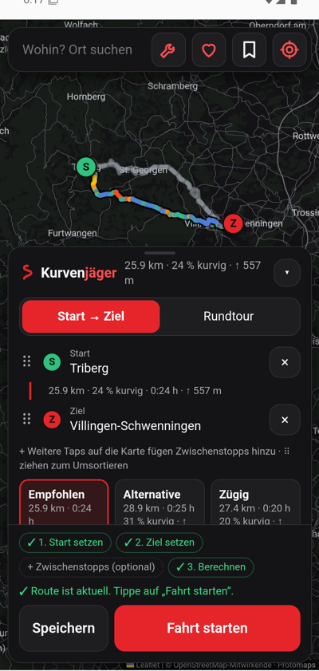
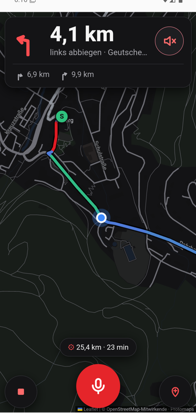

# Kurvenjäger

[](https://github.com/SchulzOli/Kurvenjagd/actions/workflows/ci.yml)
[](LICENSE)

**Kurvenreiche Motorradrouten aus OpenStreetMap** – planen, speichern, fahren. Für **Android**, **iOS** und als **Web-App**, aus einer Codebasis (Capacitor). Kostenlos für alle, Open Source, ohne Werbung, ohne Konto, ohne bezahlte Funktionen. Wer mag, unterstützt das Projekt freiwillig („zahl, was du willst“).

<p>
  
  &nbsp;
  
</p>

**Status:** Läuft und ist im Browser und im Android-Emulator getestet, aber noch nicht im Store. Als Nächstes kommt eine Android-Beta für Baden-Württemberg; Fahrplan und Stand: [docs/veroeffentlichung.md](docs/veroeffentlichung.md).

*English: Kurvenjäger plans twisty motorcycle routes from OpenStreetMap data and navigates them with voice guidance – free, open source (GPL-3.0), no ads, no accounts, everything stays on the device. The UI and docs are in German; issues and pull requests in English are welcome.*

## Was die App kann

- **Kurvige Routen** von Start über Zwischenstopps zum Ziel oder als **Rundtour**, mit einstellbarer Kurvenlust und maximalem Umweg; drei Varianten zur Wahl
- **Navigation** mit Sprachansagen, Spitzkehren-Warnung und automatischer Neuberechnung; **Sprachbefehle** wie „Tankstelle“ oder „Zwischenstopp in Todtnau“
- **Wetter und Sonne** entlang der Strecke für die geplante Abfahrtszeit (Regen, Böen, Kälte, Blendung, Dunkelheit)
- **Offline:** Regionen herunterladen, dann planen, navigieren und neu berechnen ohne Netz, mit eigener Offline-Karte
- **Persönliches Fahrprofil:** lernt aus deinen Bewertungen nach der Fahrt, ob du eher Kehren oder flotte Bögen magst – alles bleibt auf dem Gerät
- **Boxengasse:** verstecktes Technik-Fenster, das zeigt, wie eine Route entsteht (7× aufs Logo tippen)

## Algorithmus (`src/router.js`)

Die ausführliche Beschreibung inklusive aller Abhängigkeiten und Grenzen steht in [docs/algorithmus.md](docs/algorithmus.md). Kurzfassung:

1. **Daten**: Straßenpakete je 0,1°-Kachel (wöchentlich aus OpenStreetMap gebaut) mit allen Straßen von `unclassified` aufwärts, dazu Wohnstraßen im Umkreis von 1,5 km um Start, Stopps und Ziel.
2. **Graph**: Kanten laufen von Kreuzung zu Kreuzung. Einbahnstraßen und Kreisverkehre werden beachtet. Start und Ziel rasten auf die größte zusammenhängende Komponente ein.
3. **Kurvigkeit je Kante**: Die Geometrie wird alle 20 m neu abgetastet, an jedem Punkt wird der Kurvenradius bestimmt und gewichtet:
   `<30 m: 1`, `<60 m: 0,8`, `<100 m: 0,6`, `<175 m: 0,35`, `<300 m: 0,12`, sonst 0. Ergebnis: ein Wert 0..1 (echte Kurvenstrecken liegen bei 0,3–0,45).
4. **Kosten**: `Fahrzeit × Straßenklassen-Faktor^Kurvenlust × (1 − 0,85 · Kurvenlust · min(1, Kurvigkeit/0,35))`, berechnet mit Dijkstra.
   - **Start → Ziel** (mit bis zu 8 Zwischenstopps, Etappe für Etappe): Ist der Umweg größer als „Max. Umweg“ × schnellste Route, wird die Kurvenlust in 10-%-Schritten reduziert.
   - **Rundtour**: 3 Wegpunkte auf einem Kreis durch den Start, bereits gefahrene Kanten kosten ×6. Es werden 4 Ausrichtungen probiert, der Radius wird einmal auf die Ziellänge nachjustiert.

## Fahrmodus und Sprachsteuerung

Nach „Berechnen“ startet **„Fahrt starten“** die Navigation (`src/ride.js`, Logik in `src/nav.js`):

- **Manöver** werden aus der Route abgeleitet: Abbiegen an Kreuzungen (ab 25°, nicht beim bloßen Folgen derselben Straße), Spitzkehren (≥ 120° auf 60 m), Ankunft an Stopps und am Ziel.
- **Ansagen** bei 500 m / 150 m / „Jetzt“ über die Sprachausgabe des Geräts (`src/speech.js`).
- **Neuberechnung**: Mehr als 50 m neben der Route (3 GPS-Werte in Folge) wird neu berechnet, danach frühestens wieder nach 150 m Bewegung und 30 s. Liegen alle Punkte im geladenen Kartenbereich, geht das ohne Netz.
- **Sprachbefehle** über die Mikrofon-Taste (`src/voice.js`), z. B. „Zwischenstopp in Todtnau“, „Tankstelle“, „Pause“, „Nächster Halt“, „Wie weit noch?“, „Halt überspringen“, „Kurviger“, „Weniger kurvig“, „Wiederholen“, „Navigation beenden“, „Hilfe“. Ohne Spracherkennung erscheint ein Eingabefeld.
- **Schnellmenü** (Pin-Taste): Tankstelle, Pause/Café, Wie weit noch, Halt überspringen.
- **Testen ohne Motorrad**: Unter „Weitere Einstellungen“ → „Fahrt simulieren“. Alle Ansagen stehen zusätzlich in `__rideLog` (Browser-Konsole).

Hinweis iOS: Das Spracherkennungs-Plugin unterstützt Swift Package Manager noch nicht; unter iOS gibt es Sprachbefehle daher vorerst nur per Texteingabe. Sprachausgabe und „Bildschirm an“ funktionieren.

## Varianten, Wetter und Sonne

Nach dem Berechnen stehen bis zu drei **Varianten** zur Wahl: „Empfohlen“, eine eigenständige „Alternative“ und „Zügig“ (Karten im Panel oder graue Linien auf der Karte antippen). Der Bereich **„Unterwegs“** zeigt für die gewählte Abfahrtszeit das Wetter entlang der Strecke (Open-Meteo) und warnt vor Regen, Gewitter, Böen, Kälte, Hitze, **tief stehender Sonne von vorn** und Dunkelheit; betroffene Abschnitte sind auf der Karte markiert. Während der Fahrt kommen Wetterwarnungen beim Start und eine Live-Blendwarnung.

## Fahrprofil

Jede Fahrt ab 1 km wird auf dem Gerät aufgezeichnet. Danach fragt die App „Wie war die Tour?“ mit 1–5 Sternen und Schnell-Tags wie „Mehr Kurven“, „Spitzkehren super“, „Lieber flotte Bögen“ oder „Zu holprig“. Daraus lernt sie deinen Stil und passt die Gewichte des Algorithmus vorsichtig an. Tags wirken sofort, Sterne ab 3 bewerteten Fahrten. Unter „Meine Routen“ → **„Fahrten“** steht in Klartext, was gelernt wurde und warum; dort lässt sich das Profil abschalten oder zurücksetzen, und jede Fahrt kann neu bewertet, auf der Karte gezeigt oder als GPX geteilt werden. Keine Daten verlassen das Gerät.

## Offline-Regionen

Unter „Meine Routen“ → **„Offline-Regionen“** ein Gebiet herunterladen (Schwarzwald, Schwäbische Alb, Allgäu, Harz, Eifel, Sauerland, Bayerischer Wald, Pfälzerwald oder der aktuelle Kartenausschnitt). Geladen werden Straßen mit Abbiegeverboten, Höhenmodell und Ortsnamen, angepinnt und ohne Verfallsdatum. Danach funktionieren Planen, Navigation und Neuberechnung ohne Netz, und die App zeigt eine **eigene Offline-Karte** (Einstellung „Karte: Automatisch / Online / Offline“). Das Herunterladen dauert je nach Region und Verbindung einige Sekunden bis Minuten; Abbrechen und Fortsetzen sind jederzeit möglich.

## Routen speichern

Nach dem Berechnen speichert **„Speichern“** die Route unter einem Namen, **„Meine Routen“** (Lesezeichen-Taste oben) listet sie zum Laden oder Löschen. Gespeichert werden Punkte, Einstellungen und die Straßendaten (nativ im App-Datenordner, im Browser in IndexedDB). Eine geladene Route wird ohne Netz neu berechnet und kann sofort gefahren werden. Das Kartenbild braucht weiterhin Internet.

## Sprachansagen

Ein- und ausschaltbar unter „Weitere Einstellungen“ → „Sprachansagen während der Fahrt“ oder während der Fahrt über die Lautsprecher-Taste in der Manöver-Karte. Die Einstellung bleibt gespeichert; Ansagen erscheinen bei ausgeschalteter Stimme weiterhin als Texteinblendung.

## Architektur in Kürze

- `src/app.js` Planung und Oberfläche, `src/ride.js` Fahrmodus, `src/boxengasse.js` Technik-Fenster
- `src/tiles.js` lädt Straßendaten mit **Kachel-Cache** (30 Tage, nativ Dateien, im Browser IndexedDB)
- `src/engine-client.js` → **Web Worker** (`src/engine-worker.js`, `src/engine-core.js`) mit Netz, Einrasten, Routing und Manövern; Fallback im Haupt-Thread
- `src/router.js` Algorithmus (rein, ohne Abhängigkeiten; Zahlen-Spalten als Typed Arrays, Nachbarschaften als CSR), `src/nav.js` Manöver und Positionsabgleich
- `src/features.js` **Merkmale** je Straße aus OSM-Tags (Belag, Zustand, Tempolimit …) und dem Höhenmodell (steil, bergig); Gewichte in `P.weights`, einstellbar im Labor
- `src/regions.js` **Offline-Regionen**, `src/offlinemap.js` eigene **Offline-Karte**, `src/net.js` Netzstatus (nativ + gemessen)
- `src/profile.js` **Fahrprofil** (Strecken-Eigenschaften, Lernen aus Tags und Sternen, Anwenden auf `P`), `src/profile-ui.js` Bewertung und Reiter „Fahrten“
- `src/dem.js` **Höhenmodell** (AWS Terrain Tiles): Anstieg/Gefälle, Steigung, Höhenprofil; Abbiegeverbote aus OSM-Relationen in `src/router.js`

## Boxengasse (Technik-Fenster)

Verstecktes Fenster mit Einblick in die Technik, für Fahrer als Infotainment und für uns zum Debuggen und Optimieren (`src/boxengasse.js`).

- **Freischalten:** 7× schnell auf das Logo „Kurvenjäger“ tippen (wie der Android-Entwicklermodus), alternativ `?boxengasse` an die URL hängen oder während der Fahrt „Boxengasse“ sagen. Danach öffnet die Werkzeug-Taste oben bzw. ein Tipp auf die Info-Zeile in der Fahrt das Fenster. Unter „System“ lässt sie sich wieder sperren.
- **Bereiche:** Überblick (Pipeline mit echten Zeiten), Route (Kurvenprofil, Kurven-Mix, kurvigste Abschnitte), Netz (Graph, Kurvigkeits-Verteilung, Datenabruf), Fahrt (Live-GPS, Manöver, Ansagen), Profil (gelernte Anpassungen mit Zahlen, Strecken-Eigenschaften je Fahrt), Labor (alle Parameter live ändern und vergleichen), System (Dienste, Plattform, „Diagnose kopieren“), Log.

Optimierungsideen und alle infrage kommenden Datenquellen: [docs/optimierung-und-datenquellen.md](docs/optimierung-und-datenquellen.md). Betrieb, Kosten, Spendenziel und Zahlungswege („zahl, was du willst“): [docs/finanzierung-und-betrieb.md](docs/finanzierung-und-betrieb.md). Alle Abhängigkeiten mit Nutzungsgrenzen und Kosten: [docs/abhaengigkeiten-und-grenzen.md](docs/abhaengigkeiten-und-grenzen.md).

## Entwicklung

```bash
npm install
npm run build      # bündelt src/ nach www/build/
npm test           # Tests (Algorithmus, Profil, Datenbau …)
node scripts/serve.mjs   # Web-Version unter http://localhost:8765, Testdaten aus data/
```

### Daten (Straßenpakete und Karte)

Die App lädt Straßen und Kartenbild vom eigenen Speicher, nicht von öffentlichen Servern ([docs/finanzierung-und-betrieb.md](docs/finanzierung-und-betrieb.md)). Zum Entwickeln ein Testgebiet nach `data/` bauen:

```bash
pip install osmium
python scripts/build_data.py freiburg-regbez-latest.osm.pbf data --bbox 47.7,7.7,48.5,8.6
node scripts/build-map.mjs data/map.pmtiles --bbox 47.7,7.7,48.5,8.6 --maxzoom 14
```

Den OSM-Auszug gibt es bei [Geofabrik](https://download.geofabrik.de/europe/germany/baden-wuerttemberg.html). Ohne `data/` fällt die Entwicklungs-Version auf Overpass zurück. Für ganz D-A-CH baut [.github/workflows/daten.yml](.github/workflows/daten.yml) jeden Montag und lädt nach Cloudflare R2. Veröffentlichte Versionen:

```bash
KJ_DATA_URL=https://daten.example.org/v1/ npm run build -- --release
```

Optional: `KJ_MAP_URL`, `KJ_GEOCODER_URL` (eigene Photon-Instanz), `KJ_WEATHER_URL` (bezahlter Open-Meteo-Tarif), siehe [src/config.js](src/config.js).

## Android-App bauen

Voraussetzung: [Android Studio](https://developer.android.com/studio) (bringt JDK und SDK mit).

```bash
npm run android    # baut, synchronisiert und öffnet Android Studio → ▶ Run
```

APK ohne Android Studio:

```bash
npm run apk        # → dist/Kurvenjaeger-debug.apk
```

Das Skript nutzt ein portables JDK 21 und das Android SDK aus `D:\Android` oder `%LOCALAPPDATA%\Android` (`jdk-21`, `Sdk`), sonst `JAVA_HOME`/`ANDROID_HOME`. Zum Installieren die APK aufs Handy kopieren und „Installation aus unbekannten Quellen“ erlauben.

Signierte Versionen für die Veröffentlichung (Schlüssel und Ablauf: [docs/veroeffentlichung.md](docs/veroeffentlichung.md)):

```bash
KJ_DATA_URL=https://daten.example.org/v1/ npm run release:apk   # Beta-APK für GitHub (Spenden-Links)
KJ_DATA_URL=https://daten.example.org/v1/ npm run release:aab   # AAB für Google Play (Trinkgeld per In-App-Kauf)
```

### Im Emulator testen

```bash
npm run emu        # APK bauen, Emulator „Kurvenjaeger“ starten, installieren, App öffnen
npm run emu -- --no-build   # nur neu installieren und starten
```

Liegen Testdaten in `data/`, holt der Emulator sie über `adb reverse` vom Testserver am PC (`node scripts/serve.mjs` muss laufen). HTTP zu `127.0.0.1` ist dafür nur in Debug-Builds erlaubt (`android/app/src/debug`).

Das virtuelle Gerät (Pixel 7, Android 16) liegt in `D:\Android\avd`. Die GPS-Position ist auf Freiburg gesetzt; ändern lässt sie sich in `scripts/emu.mjs` oder im Emulator unter „…“ → Location. Debuggen: `chrome://inspect` in Chrome am PC.

### Auf dem Handy per USB

USB-Debugging in den Entwickleroptionen aktivieren, dann:

```bash
D:/Android/Sdk/platform-tools/adb install -r dist/Kurvenjaeger-debug.apk
```

## iOS-App bauen

Voraussetzung: **Mac mit Xcode** (unter Windows lassen sich keine iOS-Apps bauen). Projekt auf den Mac kopieren, dann:

```bash
npm install && npm run ios   # öffnet Xcode → Team wählen → ▶ Run
```

Alternative ohne Mac: ein Cloud-Build (z. B. GitHub Actions mit `macos`-Runner oder Codemagic).

## Web-App / PWA

Den Ordner `www/` (nach `npm run build`) auf einen beliebigen HTTPS-Webspace legen. Danach unter Android „Zum Startbildschirm hinzufügen“ bzw. unter iOS Safari „Teilen → Zum Home-Bildschirm“ wählen. Funktioniert ohne App Store.

## Icons neu erzeugen

```bash
npm run icons      # scripts/make-icons.py → www/icons + native Icons/Splash via @capacitor/assets
```

## Mitmachen

Fehlerberichte, Ideen, Tests auf echten Touren und Pull Requests sind willkommen – siehe [CONTRIBUTING.md](CONTRIBUTING.md) und den [Verhaltenskodex](CODE_OF_CONDUCT.md). Sicherheitslücken bitte vertraulich melden ([SECURITY.md](SECURITY.md)).

## Unterstützen

Kurvenjäger bleibt für alle kostenlos. Wer mag, hilft mit einem frei gewählten Betrag, die laufenden Kosten (Datenspeicher, Entwicklerkonten) zu tragen – in der App über ♥ „Kurvenjäger unterstützen“. Wie das aufgebaut ist und was der Betrieb kostet: [docs/finanzierung-und-betrieb.md](docs/finanzierung-und-betrieb.md).

## Lizenz

Code: [GNU General Public License v3.0 oder später](LICENSE). Kartendaten © [OpenStreetMap-Mitwirkende](https://www.openstreetmap.org/copyright) (ODbL); alle Datenquellen und Bibliotheken mit ihren Lizenzen: [NOTICE.md](NOTICE.md).
