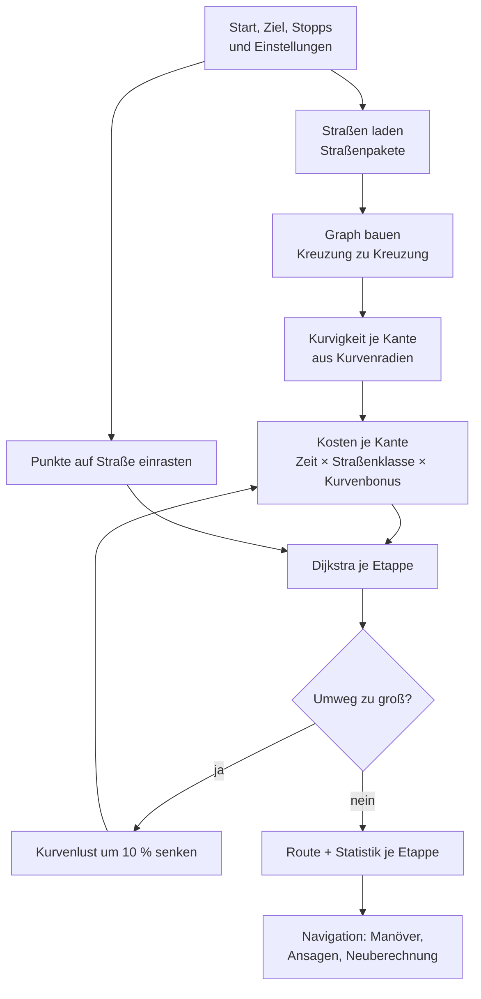
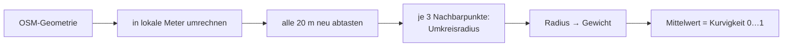
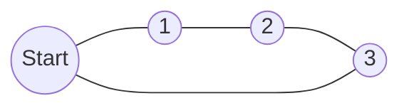

# Wie Kurvenjagd kurvige Strecken findet

Diese Doku erklärt den Routing-Algorithmus Schritt für Schritt: woher die Daten kommen, wie „Kurvigkeit“ gemessen wird, wie daraus eine Route entsteht und wovon das Ganze abhängt. Alle Zahlen stammen direkt aus dem Code; wo sie stehen, ist jeweils angegeben.

**Kurz gesagt:** Kurvenjagd lädt das Straßennetz aus OpenStreetMap, misst für jedes Straßenstück zwischen zwei Kreuzungen die Kurvenradien und sucht dann mit dem Dijkstra-Algorithmus den Weg, bei dem kurvige Straßen „billiger“ sind als gerade. Wie viel billiger, steuert der Regler „Kurvenlust“.

---

## Inhalt

1. [Überblick](#1-überblick)
2. [Abhängigkeiten](#2-abhängigkeiten)
3. [Schritt 1: Straßendaten laden](#3-schritt-1-straßendaten-laden)
4. [Schritt 2: Straßengraph bauen](#4-schritt-2-straßengraph-bauen)
5. [Schritt 3: Kurvigkeit messen](#5-schritt-3-kurvigkeit-messen)
6. [Schritt 4: Kosten pro Straßenstück](#6-schritt-4-kosten-pro-straßenstück)
7. [Schritt 5: Punkte einrasten](#7-schritt-5-punkte-auf-die-straße-einrasten)
8. [Schritt 6: Weg suchen (Dijkstra)](#8-schritt-6-weg-suchen-dijkstra)
9. [Modus Start → Ziel mit Zwischenstopps](#9-modus-start--ziel-mit-zwischenstopps)
10. [Modus Rundtour](#10-modus-rundtour)
11. [Von der Route zur Navigation](#11-von-der-route-zur-navigation) · [11.1 Persönliches Fahrprofil](#111-persönliches-fahrprofil)
12. [Speichern und Offline-Nutzung](#12-speichern-und-offline-nutzung)
13. [Grenzen und bekannte Schwächen](#13-grenzen-und-bekannte-schwächen)
14. [Stellschrauben](#14-stellschrauben)

---

## 1. Überblick



| Schritt | Code | Dauer (gemessen, Schwarzwald) |
|---|---|---|
| Straßen laden | `loadArea` in [src/tiles.js](../src/tiles.js) (Straßenpakete) | 0,1–3 s ab leerem Cache, aus dem Cache darunter (früher mit Overpass 10–90 s) |
| Graph bauen + Kurvigkeit | `buildGraph`, `curviness` | ~100–150 ms für ~9.000 Kanten |
| Route suchen | `routeVia`, `dijkstra` | ~5–20 ms |
| Rundtour suchen | `roundTrip` | ~30 ms |
| Manöver ableiten | `maneuvers` in [src/nav.js](../src/nav.js) | ~3 ms für 30 km |

Der eigentliche Algorithmus ([src/router.js](../src/router.js) und [src/nav.js](../src/nav.js)) ist reines JavaScript **ohne jede Bibliothek**. Er läuft im Browser, in der App und in Node (dort laufen die Tests).

---

## 2. Abhängigkeiten

Das ist der wichtigste Abschnitt, wenn es um Zuverlässigkeit geht. Kurvenjagd hängt von externen Diensten ab, die wir nicht kontrollieren.

### 2.1 Externe Dienste (Internet)

| Dienst | Wofür | Ohne ihn … | Regeln / Risiko |
|---|---|---|---|
| **OpenStreetMap-Daten** (Geofabrik-Auszug D-A-CH, wöchentlich zu Straßenpaketen gebaut) | Die einzige Datenquelle für Straßen, Namen, Einbahnstraßen, Zufahrtsverbote, Ortsnamen, Tankstellen. | … gibt es keine Route. | Lizenz ODbL: Namensnennung „© OpenStreetMap-Mitwirkende“ ist Pflicht (steht in der App). Die **Qualität der Route hängt direkt von der Qualität der Kartierung ab** (siehe [Abschnitt 13](#13-grenzen-und-bekannte-schwächen)). |
| **Eigener Server** (`kurvenjagd.oli-tech.eu/daten/v1/`) mit Straßenpaketen und Vektorkarte, Adresse `KJ_DATA_URL` ([src/config.js](../src/config.js)) | Straßen je 0,1°-Kachel, Nebenstraßen, Ortsnamen, Tankstellen/Rasten; die Kartendatei `map.pmtiles`. | … kann keine neue Route in einem noch nicht geladenen Gebiet geplant werden; Cache, Offline-Regionen und gespeicherte Routen funktionieren weiter. | Unser eigener Dienst (z. B. Cloudflare R2): einfache Dateien, keine Warteschlange, Kosten siehe [finanzierung-und-betrieb.md](finanzierung-und-betrieb.md). Gebaut von [.github/workflows/daten.yml](../.github/workflows/daten.yml). |
| **Overpass API** (`overpass-api.de` u. a.) | Nur noch beim Entwickeln, wenn keine Straßenpakete da sind. | – | In veröffentlichten Versionen abgeschaltet (Nutzungsregeln der Betreiber erlauben keine Apps mit viel Verkehr). |
| **Photon** (`photon.komoot.io`, Adresse `KJ_GEOCODER_URL`) | Ortssuche, Ortsnamen für die Punkte (Reverse-Geocoding), Sprachbefehl „Zwischenstopp in …“. | … gibt es keine Suche; Punkte heißen dann nur nach ihren Koordinaten. Das Routing selbst ist nicht betroffen. | Kostenloser Dienst „in vernünftigem Rahmen“; ab einigen tausend Nutzern eigene Instanz. |
| **AWS Terrain Tiles** (`s3.amazonaws.com/elevation-tiles-prod`, Terrarium-PNG, Quelle Mapzen/Tilezen) | Höhenmodell: Anstieg/Gefälle, Merkmale „steil“ und „bergig“, Höhenprofil. | … gibt es keine Höhenmeter; die Höhen-Merkmale bleiben neutral, die Route wird sonst normal berechnet. | Öffentlicher Datensatz ohne Schlüssel, CORS erlaubt. Quellenangabe der zugrunde liegenden Höhendaten (u. a. SRTM, EU-DEM) nötig. Wird 365 Tage gecacht. |
| **Open-Meteo** (`api.open-meteo.com`, Adresse `KJ_WEATHER_URL`) | Wettervorhersage entlang der Route (Temperatur, Regen, Böen, Gewitter) für die geplante Abfahrtszeit. | … gibt es keine Wetterwarnungen; Route und Sonnen-Warnungen funktionieren weiter. | Kostenlos ohne Schlüssel für nicht-kommerzielle Nutzung, kommerziell kostenpflichtig. Ob eine spendenfinanzierte App zählt, ist angefragt ([Entwurf](anfrage-open-meteo.md)). CORS erlaubt. Vorhersage bis ~15 Tage. |
| **Vektorkarte** `map.pmtiles` auf dem eigenen Speicher (aus dem Protomaps-Weltbau ausgeschnitten, [scripts/build-map.mjs](../scripts/build-map.mjs)) | Nur das **Kartenbild** im Hintergrund, gezeichnet von protomaps-leaflet (hell oder dunkel). Geländeschattierung aus dem Höhenmodell. | … ist die Karte leer; ohne Netz springt die eigene Offline-Karte ein. Route, Ansagen und Navigation funktionieren trotzdem. | Keine fremden Kachelserver mehr. Daten © OpenStreetMap (ODbL), Kartenschema Protomaps Basemaps. Braucht Range-Anfragen (jeder CDN kann das). |

### 2.2 Bibliotheken

| Bibliothek | Wofür | Betrifft den Algorithmus? |
|---|---|---|
| Leaflet 1.9.4 | Kartenanzeige, Marker, Linien | Nein, nur Anzeige |
| protomaps-leaflet 5, @protomaps/basemaps 5, pmtiles 4 | Vektorkarte aus einer PMTiles-Datei zeichnen | Nein, nur Anzeige |
| fflate | gzip entpacken (Straßenpakete), falls der Browser es nicht selbst kann | Nein |
| Capacitor 8 | Verpackt die Web-App als Android-/iOS-App | Nein |
| `@capacitor/filesystem`, `@capacitor/share` | Routen speichern, GPX teilen | Nein |
| `@capacitor-community/text-to-speech` | Sprachansagen (nativ) | Nein |
| `@capacitor-community/speech-recognition` | Sprachbefehle (nativ). **Unter iOS derzeit nicht eingebunden** (kein Swift-Package-Support) | Nein |
| `@capacitor-community/keep-awake` | Bildschirm bleibt während der Fahrt an (auch beim Region-Download) | Nein |
| `@capacitor/network` | Zuverlässiger Netzstatus auf Android/iOS (die WebView meldet sonst oft „online“) | Nein |
| esbuild | Bündelt den Code beim Bauen | Nein |
| pyosmium 4 (nur beim Datenbau) | Liest den OSM-Auszug in [scripts/build_data.py](../scripts/build_data.py) | Ja: liefert die Straßen |

### 2.3 Gerät

| Funktion | Quelle | Hinweis |
|---|---|---|
| Position | GPS des Geräts (`navigator.geolocation`) | Nur bei geöffneter App; kein Hintergrund-Tracking |
| Sprachausgabe | Sprach-Engine des Betriebssystems | Eine deutsche Stimme muss installiert sein |
| Spracherkennung | Android: Google-Spracherkennung; Browser: Web Speech API (praktisch nur Chrome) | Braucht teils Internet. Fallback: Texteingabe |

### 2.4 Was offline funktioniert

| Funktion | Neue Planung | Gespeicherte Route |
|---|---|---|
| Route berechnen | ✅ in **heruntergeladenen Offline-Regionen** (verfallen nicht) und in Gebieten aus dem Kachel-Cache (30 Tage), sonst ❌ braucht die Straßenpakete. Offline rasten Punkte auf Hauptstraßen ein (Wohnstraßen fehlen). | ✅ |
| Navigation, Manöver, Ansagen | – | ✅ (Sprachausgabe nativ meist offline) |
| Neuberechnung beim Verfahren | – | ✅ solange man im gespeicherten Gebiet bleibt |
| Sonnenstand, Blendung | ✅ (reine Berechnung) | ✅ |
| Wetter unterwegs | ❌ braucht Open-Meteo | ❌ |
| Höhenmeter, Höhenprofil | ✅ wenn die Höhen-Kacheln im Cache liegen (365 Tage) | ✅ (in der Route gespeichert) |
| Kartenbild | ✅ **eigene Offline-Karte** in heruntergeladenen Regionen (Straßen, Schummerung, Ortsnamen; ab Zoom 8) | ✅ im Gebiet einer Offline-Region |
| Ortssuche, „Zwischenstopp in …“ | ❌ | ❌ |
| „Tankstelle“ / „Pause“ | ✅ soweit die Kacheln im Cache liegen (Tankstellen und Rasten stecken in den Straßenpaketen) | ✅ entlang der Route |

---

## 3. Schritt 1: Straßendaten laden

Code: `loadArea` in [src/tiles.js](../src/tiles.js), [src/data.js](../src/data.js), `bboxForPoints`, `bboxForLoop` in [src/router.js](../src/router.js). Paketbau: [scripts/build_data.py](../scripts/build_data.py).

### 3.1 Welcher Ausschnitt?

- **Start → Ziel:** das Rechteck um alle Punkte, auf jeder Seite erweitert um 25 % der größeren Kantenlänge, mindestens 0,04° (~4,5 km). Ist das Rechteck größer als 1,1° Breite × 1,6° Länge (~110 km Luftlinie), bricht die App ab. Mehr Daten würden die öffentlichen Server überfordern.
- **Rundtour:** ein Quadrat um den Start mit Radius `2,4 × Tourlänge / 7,9 + 2 km`. Warum 7,9: siehe [Abschnitt 10](#10-modus-rundtour).

### 3.2 Welche Straßen?

Die Straßenpakete enthalten zwei Mengen (getrennte Dateien je Kachel):

1. **Hauptstraßen im ganzen Ausschnitt:** `motorway`, `trunk`, `primary`, `secondary`, `tertiary` (jeweils mit `_link`) und `unclassified`. Gerade `unclassified` ist wichtig: Viele der schönsten kleinen Bergstraßen sind in OSM so eingetragen.
2. **Wohnstraßen nur im Umkreis von 1.500 m um jeden Punkt** (`residential`, `living_street`). Sonst würde die Datenmenge in Städten explodieren, und durch Wohngebiete will man ohnehin nicht fahren. Sie werden nur gebraucht, damit Start und Ziel in einer Siedlung erreichbar sind.

Ausgeschlossen werden Wege mit `access`, `motor_vehicle` oder `motorcycle` = `no`/`private` sowie Flächen (`area=yes`). Gar nicht abgefragt werden Feld- und Waldwege (`track`), `service`, Rad- und Fußwege.

### 3.3 Straßenpakete statt Abfragen

Früher fragte die App die öffentlichen Overpass-Server – im Test 21–150 s Wartezeit, oft Überlastung (502/504), und die Nutzungsregeln der Betreiber schließen eine verbreitete App aus. Jetzt:

- **Bau (wöchentlich, [.github/workflows/daten.yml](../.github/workflows/daten.yml)):** Geofabrik-Auszug D-A-CH → [scripts/build_data.py](../scripts/build_data.py) (pyosmium) → je 0,1°-Kachel `roads/t{i}_{j}.json.gz` (Hauptstraßen, Abbiegeverbote, Ortsnamen, Tankstellen/Rasten) und `local/t{i}_{j}.json.gz` (Wohn- und Spielstraßen), dazu `manifest.json` mit Bauzeit, OSM-Stand und vorhandenen Kacheln. Straßenklassen, Zufahrts-Regeln und Tags liest das Skript direkt aus dem App-Code, damit beide nie auseinanderlaufen. Das Format entspricht dem Kachel-Cache der App.
- **Laden:** fehlende Kacheln als Dateien vom eigenen Speicher, 6 gleichzeitig; Wohnstraßen aus den `local`-Kacheln rund um jeden Punkt, auf 1.500 m gefiltert. Dateien dürfen mit oder ohne `Content-Encoding: gzip` ankommen.
- **Aktualität:** Kacheln aus einem älteren Bau werden beim nächsten Laden ersetzt (angepinnte Regions-Kacheln erst beim Aktualisieren der Region).
- **Abdeckung:** Liegt ein Punkt außerhalb der Pakete, meldet die App „nicht abgedeckt“. Beim Entwickeln ergänzt dann Overpass (`CONFIG.overpassFallback`).
- **Gemessen** (Testgebiet Schwarzwald, Route Triberg → Villingen): identisches Straßennetz und identische Route wie mit Overpass; Planung ab leerem Cache **0,5 s im Browser, 4,1 s im Android-Emulator** (937 KB Pakete) statt 42–150 s.

### 3.4 Kachel-Cache

Geladene Straßen werden dauerhaft zwischengespeichert (nativ als Dateien im App-Ordner `cache/`, im Browser in IndexedDB), 30 Tage lang:

- **Hauptstraßen je Kachel** von 0,1° × 0,1° (~11 × 7,5 km). Ein Weg über eine Kachelgrenze wird in jeder berührten Kachel abgelegt und beim Laden über seine ID wieder zusammengeführt.
- **Wohnstraßen je Punkt-Umkreis** (1.500 m), auffindbar über ein 0,01°-Raster. Ein Eintrag passt, wenn sein Mittelpunkt näher als 1.200 m am neuen Punkt liegt.
- **Wohnstraßen** je Paket-Kachel (Schlüssel `L…`), beim Laden auf den Umkreis der Punkte gefiltert.
- Gleiche Planung nach Neustart: **0,26 s im Browser, 0,75 s auf Android**, ohne eine einzige Netzanfrage.

Der Cache lässt sich in der Boxengasse (System) leeren.

### 3.5 Offline-Regionen

Code: [src/regions.js](../src/regions.js), Karte in [src/offlinemap.js](../src/offlinemap.js).

- **Herunterladen:** Eine Region (8 Voreinstellungen wie „Schwarzwald“ oder der aktuelle Kartenausschnitt, max. 1,6° × 1,6°) lädt die Paket-Kacheln (Hauptstraßen, Abbiegeverbote, Ortsnamen, Tankstellen) blockweise zu 4 × 4 Kacheln, dazu das Höhenmodell (Zoom 11). Schwarzwald: 156 Kacheln, ca. 37 MB im Speicher.
- **Anpinnen:** Die Kacheln bekommen die Regions-ID als „Pin“ und verfallen nicht. Schon vorhandene, frische Kacheln werden nur angeheftet statt neu geladen. Abbrechen ist nach jedem Block möglich, „Fortsetzen“ lädt nur den Rest, „Aktualisieren“ alles neu. Löschen löst die Pins; Kacheln, die keine andere Region mehr braucht, verfallen dann normal.
- **Netz erkennen:** `navigator.onLine` reicht nicht – die Android-WebView meldet im Test „online“, obwohl WLAN und mobile Daten aus waren. Deshalb zählt zusätzlich der native Status (`@capacitor/network`) und „gemessenes“ Offline: Scheitert eine Anfrage ohne Server-Antwort, gilt das Netz 60 s als weg ([src/net.js](../src/net.js)). Vorher hing eine Offline-Planung 30 s und länger in Wiederholungen, jetzt dauert sie 1,4 s.
- **Offline planen:** Ohne Netz meldet der Lader sofort, wenn ein Gebiet fehlt, statt minutenlang auf Server zu warten. Fehlen nur Wohnstraßen-Umkreise, wird mit Hauptstraßen weitergerechnet. Das Höhenmodell weicht offline auf Zoom 11 aus.
- **Eigene Offline-Karte:** Ohne Netz zeichnet die App ihre Karte selbst: Schummerung aus dem Höhenmodell (Licht aus Nordwest, 64 × 64 Punkte je Kachel, hochskaliert), Straßen aus dem Kachel-Cache nach Klasse eingefärbt und Ortsnamen aus Regionen und Paket-Kacheln. „Karte: Automatisch“ schaltet ohne Netz um. Online zeigt die App die Vektorkarte vom eigenen Speicher; „Gelände-Schattierung“ legt dieselbe Schummerung halbtransparent darüber.

### 3.6 Nachladen statt neu laden

Bereits geladene Daten im Arbeitsspeicher werden wiederverwendet:
- Liegen alle Punkte (mit ~2 km Rand) im geladenen Rechteck, wird nichts Neues geladen.
- Kommt ein Punkt hinzu, der weiter als 1.200 m von jedem bisherigen entfernt ist, werden **nur dessen Wohnstraßen** nachgeladen.
- Während der Fahrt wird gar nichts nachgeladen, damit Neuberechnungen ohne Netz gehen.

---

## 4. Schritt 2: Straßengraph bauen

Code: `buildGraph`, `addEdge`, `largestComponent`, `onewayDir`.

Ein OSM-Weg ist eine Linie aus vielen Punkten. Für die Wegsuche brauchen wir einen **Graphen**: Knoten = Kreuzungen, Kanten = Straßenstücke dazwischen.

1. **Knoten:** Ein OSM-Punkt wird Graph-Knoten, wenn er Anfang oder Ende eines Weges ist oder von mehreren Wegen geteilt wird (Kreuzung). Alle anderen Punkte bleiben Formpunkte innerhalb der Kante.
2. **Kanten:** Jedes Stück zwischen zwei Knoten wird eine Kante mit Geometrie, Länge (Haversine), Straßenklasse, Name/Nummer und Kurvigkeit.
3. **Einbahnstraßen:** `oneway=yes/1/true` → nur in Zeichenrichtung; `oneway=-1` → nur entgegen; Kreisverkehre (`junction=roundabout/circular`) und Autobahnen gelten automatisch als Einbahnstraße.
4. **Größte Komponente:** Mit Union-Find werden zusammenhängende Teilnetze gesucht. Nur das größte zählt beim Einrasten, damit Start oder Ziel nicht auf einem isolierten Straßenstück landen (z. B. ein am Rand abgeschnittenes Stück).

5. **Abbiegeverbote:** Die Straßenpakete enthalten je Kachel die Relationen `type=restriction`, die eine ihrer Straßen enthalten. `no_*` (z. B. `no_left_turn`) verbietet „von Weg A über Knoten V nach Weg B“, `only_*` erlaubt ab A über V nur noch B. Gilt `restriction:motorcycle`, hat es Vorrang; steht `motorcycle` in `except`, wird das Verbot ignoriert. Gespeichert wird über **Weg-IDs**, damit das Teilen von Kanten beim Einrasten nichts verändert. Noch nicht unterstützt: Verbote mit einem Weg (statt Knoten) als „via“ und zeitabhängige Verbote. Im Schwarzwald-Test: 1.091 Verbote an 964 Kreuzungen, 72 übersprungen.

---

## 5. Schritt 3: Kurvigkeit messen

Code: `curviness`, `resample`, `circumRadius`, `bendWeight` in [src/router.js](../src/router.js). Das ist der Kern des Ganzen.

### 5.1 Idee

Eine Straße ist kurvig, wenn ein großer Teil ihrer Länge in **engen Radien** verläuft. Wir messen also an vielen Stellen den Kurvenradius und gewichten: je enger, desto mehr zählt es. Die Radius-Stufen sind angelehnt an das Projekt roadcurvature.com von Adam Franco; die Gewichte sind eigene Werte.

### 5.2 Ablauf für eine Kante



1. **Lokale Meter:** Längen- und Breitengrade werden flach in Meter umgerechnet (`x = Δlon · 111.320 · cos(lat)`, `y = Δlat · 110.540`). Für Kantenlängen von wenigen Kilometern ist der Fehler vernachlässigbar.
2. **Neu abtasten alle 20 m:** OSM-Punkte sind sehr unregelmäßig verteilt; mal liegt alle 2 m einer, mal alle 300 m. Würde man direkt mit ihnen rechnen, sähe eine dicht gezeichnete Straße kurviger aus als eine grob gezeichnete. Gleichmäßige 20-m-Abstände machen Straßen vergleichbar und glätten Zeichen-Zittern.
3. **Umkreisradius:** Für jeden Punkt B mit Nachbarn A und C wird der Radius des Kreises durch alle drei berechnet:

   ```
   R = |AB| · |BC| · |CA| / (2 · |(B − A) × (C − A)|)
   ```

   Liegen die Punkte auf einer Linie, ist das Kreuzprodukt 0 und R = ∞.
4. **Gewicht nach Radius** (`P.bands`):

   | Radius | Gewicht | Typisch für |
   |---|---|---|
   | < 30 m | 1,00 | Spitzkehre, Serpentine |
   | 30–60 m | 0,80 | enge Kurve |
   | 60–100 m | 0,60 | deutliche Kurve |
   | 100–175 m | 0,35 | flotte Kurve |
   | 175–300 m | 0,12 | sanfter Bogen |
   | ≥ 300 m | 0 | praktisch gerade |

5. **Kurvigkeit** = Mittelwert der Gewichte über alle inneren Abtastpunkte, also ein Wert von 0 (gerade) bis 1 (durchgehend Spitzkehren). Kanten mit weniger als drei Abtastpunkten (kürzer als ~40 m) bekommen 0.

### 5.3 Wie sich die Werte anfühlen

| Situation | Kurvigkeit |
|---|---|
| Gerade Straße | 0 |
| Halbkreis mit 40 m Radius (Test) | ≈ 0,80 |
| Viertelkreis mit 120 m Radius (Test) | ≈ 0,35 |
| Schauinslandstraße L 124, typisches Stück (echte Daten) | ≈ 0,34 |
| Kurvigste Stücke > 1,5 km im Raum Freiburg | 0,32–0,41 |

Echte, sehr kurvige Straßen liegen also bei **0,3–0,45**; Werte nahe 1 erreichen nur kurze Kehren-Stücke. Deshalb gilt:
- Ab **0,15** zählt eine Kante in der Statistik als „kurvig“ (`P.curveMin`).
- Ab **0,35** gibt es den vollen Kurvenbonus (`P.curveSat`).

### 5.4 Warum Kurven an Kreuzungen nicht zählen

Die Kurvigkeit wird **pro Kante** gemessen, also nur zwischen zwei Kreuzungen. Ein Abbiegen an einer Kreuzung (90°-Ecke) ist kein Kurvenfahren und erhöht die Kurvigkeit nicht. Nebeneffekt: Eine Kurve, die genau über einer Einmündung liegt, wird geteilt und etwas unterschätzt.

---

## 6. Schritt 4: Kosten pro Straßenstück

Code: `edgeTime`, `costArray` in [src/router.js](../src/router.js), Merkmale in [src/features.js](../src/features.js).

Dijkstra sucht den Weg mit den **geringsten Gesamtkosten**. Die Kosten einer Kante sind:

```
Kosten = Fahrzeit × Straßenklassen-Faktor(Kurvenlust) × Kurvenbonus(Kurvenlust) × Π (1 + Gewichtᵢ × Merkmalᵢ)
```

Die Berechnung läuft über **Zahlen-Spalten (Typed Arrays)** statt über Kanten-Objekte: Länge, Kurvigkeit, Straßenklasse und alle Merkmale liegen kompakt hintereinander. Werte je Straßenklasse werden einmal vorab bestimmt, Merkmale mit Gewicht 0 überspringt die Schleife. Gemessen: Kostenberechnung −65 % (Schwarzwald, 9.000 Kanten) bzw. −74 % (51.000 Kanten), bei exakt gleichen Werten wie die frühere Formel (72.592 Kosten verglichen, Abweichung 0).

### 6.1 Fahrzeit

```
Geschwindigkeit = Grundtempo(Klasse) × (0,6 falls Auffahrt) × (1 − 0,4 × Kurvigkeit)
Fahrzeit = Länge / Geschwindigkeit
```

| Klasse | Grundtempo km/h | Faktor bei Kurvenlust 100 % |
|---|---|---|
| motorway (Autobahn) | 120 | 5 |
| trunk (Kraftfahrstraße) | 100 | 3 |
| primary (Bundesstraße) | 90 | 1,5 |
| secondary (Landesstraße) | 80 | 1 |
| tertiary (Kreisstraße) | 70 | 0,85 |
| unclassified (Nebenstraße) | 60 | 0,8 |
| residential (Wohnstraße) | 30 | 2 |
| living_street (Spielstraße) | 10 | 4 |

Die Abbremsung in Kurven (bis −40 %) sorgt dafür, dass Fahrzeit-Schätzungen realistischer werden und kurvige Straßen bei Kurvenlust 0 nicht bevorzugt werden.

### 6.2 Straßenklassen-Faktor

```
Faktor = 1 + (Tabellenwert − 1) × Kurvenlust
```

Bei Kurvenlust 0 ist der Faktor überall 1 (reine schnellste Route). Bei 100 % sind Autobahnen fünfmal so teuer, Kreis- und Nebenstraßen etwas billiger.

### 6.3 Kurvenbonus

```
Bonus = 1 − 0,85 × Kurvenlust × min(1, Kurvigkeit / 0,35)
```

Bei voller Kurvenlust und einer Straße mit Kurvigkeit ≥ 0,35 kostet sie nur noch **15 %** ihrer normalen Zeit.

### 6.4 „Autobahn und Schnellstraße meiden“

Ist der Haken gesetzt, bekommen `motorway`, `trunk` und ihre Auffahrten die Kosten ∞: Sie werden nie benutzt.

### 6.5 Rechenbeispiel (Kurvenlust 80 %)

| | Gerade Landesstraße | Kurvige Kreisstraße |
|---|---|---|
| Länge | 1 km | 1 km |
| Kurvigkeit | 0 | 0,35 |
| Geschwindigkeit | 80 km/h | 70 × (1 − 0,14) = 60,2 km/h |
| Fahrzeit | 45 s | 59,8 s |
| Klassen-Faktor | 1 + 0 × 0,8 = 1 | 1 + (−0,15) × 0,8 = 0,88 |
| Bonus | 1 | 1 − 0,85 × 0,8 × 1 = 0,32 |
| **Kosten** | **45** | **16,8** |

Ein Kilometer kurvige Kreisstraße „kostet“ also nur 37 % eines geraden Kilometers. Der Algorithmus nimmt dafür rund **2,7-mal längere Wege** in Kauf, wenn sie entsprechend kurvig sind. Das „Max. Umweg“-Limit begrenzt das (siehe [Abschnitt 9](#9-modus-start--ziel-mit-zwischenstopps)).

---

### 6.6 Merkmale aus OSM-Tags

Beim Aufbau des Netzes bekommt jede Kante einmalig einen Satz **Merkmale** (Werte 0…1), abgeleitet aus Tags, die die Straßenpakete ohnehin mitliefern:

| Merkmal | OSM-Tags | Wert | Standardgewicht |
|---|---|---|---|
| Unbefestigt | `surface` = gravel, dirt, compacted, ground … | 1 | **4** (deutlich meiden) |
| Kopfsteinpflaster | `surface` = sett, cobblestone, paving_stones | 1 | 0,5 |
| Schlechter Zustand | `smoothness` intermediate / bad / very_bad … | 0,3 / 0,7 / 1 | 1 |
| Tempolimit ≤ 50 | `maxspeed` ≤ 50, `DE:urban` | 1 | 0 |
| Schmal | `lanes=1` (Gegenverkehr) oder `width` < 4 m | 1 | 0 |
| Tunnel | `tunnel` | 1 | 0 |
| Maut | `toll=yes` | 1 | 0 |

- **Wirkung:** Kosten × (1 + Gewicht × Wert). Positives Gewicht = meiden, negatives = bevorzugen (minimal −0,9). Alle Gewichte stehen in `P.weights` und sind im Labor der Boxengasse einstellbar.
- **Fehlende Daten sind neutral:** Hat eine Straße kein Tag, ist der Wert 0 und die Kosten ändern sich nicht. Die Boxengasse zeigt unter „Netz“ die **Datenabdeckung**. Gemessen im Schwarzwald: Belag 82–85 %, Tempolimit 51 %, Breite/Spuren 54 %, Straßenzustand nur 13 %.
- **Neues Merkmal hinzufügen:** in `src/features.js` eintragen und ein Gewicht in `P.weights` setzen. Speichern, Kostenberechnung, Labor und Statistik passen sich automatisch an.
- Mit den Standardgewichten änderten sich im Testgebiet 1 von 39 Zufallsrouten; mit allen Gewichten auf 0 rechnet der Kern exakt wie vor der Pipeline.

### 6.7 Höhenmodell

Code: [src/dem.js](../src/dem.js), geladen in [src/tiles.js](../src/tiles.js).

- **Quelle:** AWS Terrain Tiles (Terrarium-Kodierung: Höhe = R·256 + G + B/256 − 32768 m). Zoom 12 (~25 m Raster in Mitteleuropa), bei großen Gebieten Zoom 11 (~50 m). Geladen parallel zu den Straßen, 6 Kacheln gleichzeitig, 365 Tage gecacht. Fehlende Kacheln sind kein Fehler.
- **Je Kante:** alle 30 m eine Höhe (bilinear interpoliert, über 3 Punkte geglättet). Daraus Anstieg und Gefälle in Zeichenrichtung sowie die Steigung über je ~90 m.
- **Merkmale:** *steil* = Anteil der Kante, der steiler als 8 % ist; *bergig* = Höhenmeter je km (60 Hm/km = 1). Beide haben Standardgewicht 0. Ein negatives Gewicht bei „bergig“ sucht gezielt Bergstrecken, ein positives bei „steil“ meidet Steigungen.
- **Warum Anteil statt größter Steigung:** Die erste Version nahm die steilste Stelle je Kante. Dann galt im Schwarzwald fast jede Straße als steil (einzelne Ausreißer im Raster, lange Kanten). Mit dem Anteil sind gewichtet 262 von 2.756 km steil und 801 km bergig.
- **Routen-Statistik:** Anstieg und Gefälle je Etappe und gesamt (in Fahrtrichtung), in der Zeitleiste und als Höhenprofil in der Boxengasse.
- **Grenzen:** Die Rastergröße (25–50 m) glättet sehr enge Kehren; Brücken und Tunnel folgen im Höhenmodell dem Gelände, nicht der Fahrbahn.

## 7. Schritt 5: Punkte auf die Straße einrasten

Code: `snapToRoad`.

Ein Tipp auf die Karte liegt selten exakt auf einer Straße. Kurvenjagd sucht die **nächstgelegene Stelle auf einer befahrbaren Kante** (Lotfußpunkt auf jedes Liniensegment). Dabei zählen nur Kanten im größten Teilnetz, die nicht gesperrt sind; bei „Autobahn meiden“ also nie eine Autobahn.

**Räumliches Raster:** Damit nicht jede Kante geprüft werden muss, liegen alle Kanten in Zellen von 0,005° (~550 × 370 m), eingetragen in jede Zelle, die ihre Ausdehnung berührt. Gesucht wird ringförmig um den Punkt; sobald der beste Treffer näher liegt als der nächste noch ungeprüfte Ring, ist das Ergebnis sicher das gleiche wie bei der Prüfung aller Kanten. Auf echten Daten (300 Zufallspunkte) identisch, aber ~7× schneller (0,07 statt 0,48 ms pro Punkt); der Vorteil wächst mit der Gebietsgröße. Beim Teilen entstehende Kanten werden sofort ins Raster eingetragen.

- Liegt der Fußpunkt näher als 15 m an einem Kantenende, wird dieser Knoten genommen.
- Sonst wird die Kante dort **geteilt**: Es entsteht ein neuer Knoten, und die alte Kante wird durch zwei neue ersetzt. Die Einbahn-Richtung bleibt erhalten, die Kurvigkeit wird für beide Hälften neu gemessen.

Früher sprangen Punkte nur zur nächsten Kreuzung; das ergab Lücken von bis zu 1,1 km. Mit dem Teilen bleibt nur noch der echte Abstand zur Straße (auf der Karte gestrichelt).

---

## 8. Schritt 6: Weg suchen (Dijkstra)

Netz, Einrasten und Suche laufen in einem **Web Worker** (eigener Thread, [src/engine-core.js](../src/engine-core.js), [src/engine-worker.js](../src/engine-worker.js)). Die Oberfläche bleibt dadurch auch bei großen Gebieten flüssig. Der Haupt-Thread bekommt nur reine Daten zurück: Routen-Koordinaten, Kanten-Infos für die Anzeige und die fertig abgeleiteten Manöver. Kann ein Gerät keine Module-Worker, läuft derselbe Kern automatisch im Haupt-Thread ([src/engine-client.js](../src/engine-client.js)); welcher Modus aktiv ist, zeigt die Boxengasse.

Code: `dijkstra`, `MinHeap`.

Dijkstra mit binärem Heap, **zweistufig wegen der Abbiegeverbote**:
1. Schnelle Suche über Knoten (ohne Verbote).
2. Enthält der gefundene Weg ein verbotenes Abbiegen, rechnet eine Suche über **gerichtete Kanten** nach. Ihr Zustand ist „auf welcher Kante bin ich angekommen“, so lässt sich jeder Übergang prüfen; Wenden auf derselben Kante ist dort nur in Sackgassen erlaubt.

Das ist immer korrekt: Ist der schnellste Weg insgesamt erlaubt, ist er auch der schnellste erlaubte. Stufe 2 ist 2–5× teurer, wird aber nur gebraucht, wenn ein Verbot tatsächlich im Weg liegt (Schwarzwald-Test: 1× pro Route).
- Sie bricht ab, sobald das Ziel erreicht ist.
- Bereits benutzte Kanten können optional ×6 verteuert werden (`P.reusePenalty`), damit spätere Etappen nicht denselben Weg zurückfahren.
- Rechenaufwand O((V + E) log V). Bei ~9.000 Kanten dauert eine Suche wenige Millisekunden.

Warum kein A*? Wegen des Kurvenbonus kann eine Kante bis auf 15 % ihrer Fahrzeit „billig“ werden. Eine zulässige A*-Schätzung müsste so vorsichtig sein, dass sie kaum noch etwas bringt. Bei den Netzgrößen im Prototyp ist Dijkstra schnell genug.

---

## 9. Modus Start → Ziel mit Zwischenstopps

Code: `routeVia`, `routeLegs`.

1. Alle Punkte (Start, Stopps, Ziel) werden eingerastet.
2. **Referenzroute:** die schnellste Route durch dieselben Punkte (Kurvenlust 0, ohne Wiederhol-Strafe). Sie erscheint grau gestrichelt und dient als Vergleich.
3. **Kurvenroute:** Etappe für Etappe Dijkstra mit den Kurven-Kosten. Kanten aus früheren Etappen kosten in späteren ×6, damit man z. B. nach einem Stopp in einem Tal nicht dieselbe Straße zurückfährt. Verboten ist das nicht; bei Sackgassen-Stopps bleibt es möglich.
4. **Umweg-Grenze:** Ist die Kurvenroute länger als `Max. Umweg × Referenzlänge` (Standard ×1,8), sucht eine **Binärsuche** in 4 Schritten die größte Kurvenlust, bei der die Grenze eingehalten wird (Genauigkeit 1/16 der eingestellten Kurvenlust). Das sind höchstens 5 Läufe statt früher bis zu 9. Die App zeigt an, auf welchen Wert reduziert wurde; die Boxengasse zeigt alle probierten Werte.
5. **Statistik je Etappe:** Länge, Fahrzeit, kurvige Strecke und Ø-Kurvigkeit, angezeigt in der Zeitleiste.

**Einsortieren neuer Stopps:** Ein per Tipp hinzugefügter Stopp wird dort eingefügt, wo er den kleinsten Umweg nach **Luftlinie** erzeugt (`d(A,P) + d(P,B) − d(A,B)` minimal). Das ist eine Schätzung; per Drag & Drop lässt sich jede Reihenfolge erzwingen.

---

### 9.1 Alternativrouten

Nach der Hauptroute rechnet der Kern zwei weitere Varianten (Code: `alternativeRoute`, `overlap` in [src/router.js](../src/router.js)):

- **Alternative:** dieselben Punkte, aber jede Kante der Hauptroute kostet das 1,8-Fache. So entsteht eine eigenständige zweite Variante, die nur dort mit der Hauptroute zusammenläuft, wo es keine sinnvolle andere Straße gibt.
- **Zügig:** die schnellste Route (Kurvenlust 0), die ohnehin als Vergleich berechnet wird.
- Angezeigt wird eine Variante nur, wenn höchstens 80 % ihrer Strecke mit der Hauptroute übereinstimmen. Jede bringt eigene Manöver und Etappenwerte mit; die Auswahl wird mit einer gespeicherten Route gemerkt.
- Die Hauptroute heißt **„Empfohlen“**: Sie ist die beste nach der Gesamtbewertung (Kurven, Straßenart, Merkmale), nicht zwingend die mit dem höchsten Kurvenanteil. Im Test war die Alternative einmal kurviger (54 % zu 52 %), dafür mit 1.644 statt 1.205 Höhenmetern.

### 9.2 Bedingungen unterwegs: Wetter und Sonne

Code: [src/weather.js](../src/weather.js), [src/sun.js](../src/sun.js).

- **Abfahrtszeit** wählbar (Standard: jetzt, auf 5 Minuten gerundet). Jeder Punkt der Route bekommt eine Ankunftszeit, gleichmäßig über die Fahrzeit verteilt.
- **Wetter:** alle 15 km ein Punkt (2–12), eine einzige Open-Meteo-Abfrage für alle Punkte, jeweils die nächste volle Stunde. Warnungen: Regen (Wahrscheinlichkeit ≥ 60 % oder ≥ 0,3 mm/h oder Regen-Wettercode), Gewitter (Code 95–99), Böen ≥ 55 km/h, ≤ 3 °C (Glätte möglich), ≥ 32 °C. Ergebnisse werden 30 Minuten gecacht.
- **Sonne:** Sonnenstand nach den astronomischen Formeln wie in SunCalc (geprüft: München 21. Juni Aufgang 05:14, Untergang 21:18 gegen Referenz 05:13/21:17). **Blendung**, wenn die Sonne unter 25° steht und höchstens 35° neben der Fahrtrichtung, alle 250 m geprüft, Abschnitte ab 400 m. Dazu Warnungen bei Abfahrt vor Sonnenaufgang oder Ankunft nach Sonnenuntergang.
- **Anzeige:** Zusammenfassung und Warnungen im Bereich „Unterwegs“, betroffene Abschnitte auf der Karte markiert (gelb Blendung, blau Regen), Details je Punkt in der Boxengasse.
- **Fahrt:** Beim Start werden bis zu zwei Wetterwarnungen angesagt. Unterwegs prüft die App alle 20 s die aktuelle Fahrtrichtung gegen den Sonnenstand und warnt höchstens alle 10 Minuten vor Blendung.

## 10. Modus Rundtour

Code: `roundTrip`, `loopCandidate`, `offset`, `mulberry32`.



1. **Geometrie:** Der Start liegt auf einem Kreis mit Radius R. Drei weitere Wegpunkte liegen um je 90° versetzt auf demselben Kreis; zusammen bilden sie ein Quadrat.
2. **Radius aus der Wunschlänge:** Der Umfang eines Quadrats im Kreis ist 4√2·R ≈ 5,66·R. Straßen sind im Schnitt ~1,4-mal länger als die Luftlinie. Daraus folgt `R = Tourlänge / 7,9` (`P.loopShape`).
3. **Richtungen:** Ein Zufallswinkel (mit festem Startwert, „Neu würfeln“ erhöht ihn) plus 4 gleichmäßig verteilte Ausrichtungen. Für jede werden die Wegpunkte auf die nächste Straße gelegt und die vier Etappen mit Wiederhol-Strafe berechnet.
4. **Bewertung:**

   ```
   Score = Ø-Kurvigkeit − 0,6 × |Länge − Wunschlänge| / Wunschlänge − 0,5 × doppelt gefahren / Länge
   ```

   Die Kandidatin mit dem höchsten Score gewinnt.
5. **Nachjustieren:** Weicht die Länge um mehr als 15 % ab, wird R mit dem Verhältnis Wunsch/Ist skaliert (begrenzt auf 0,6–1,4) und ein zweiter Durchgang gerechnet.

Das ist eine **Heuristik**: Sie probiert 4–8 Varianten und findet nicht garantiert die kurvigste mögliche Rundtour.

---

## 11. Von der Route zur Navigation

Code: [src/nav.js](../src/nav.js), [src/ride.js](../src/ride.js). Kurz, weil es nicht mehr um die Kurvensuche geht, sondern darum, was die Fahrt daraus macht.

- **Abbiege-Manöver:** An jedem Kantenübergang, an dem mindestens 3 Straßen zusammentreffen, wird der Winkel zwischen den 25 m davor und danach gemessen.
  - Ab 25° gibt es eine Ansage: unter 60° „leicht“, ab 130° „scharf“.
  - Kein Manöver, wenn man unter 60° auf einer Straße mit gleichem Namen bleibt.
  - Zwei Manöver unter 40 m Abstand (getrennte Fahrbahnen) werden zusammengefasst.
- **Spitzkehren:** Dreht die Fahrtrichtung innerhalb von 60 m um mindestens 120° (und nicht an einer Kreuzung), wird „Spitzkehre links/rechts“ gemeldet.
- **Ansagen:** Abbiegen bei 500 m, 150 m und „Jetzt“ (40 m); Spitzkehren bei 300 und 80 m; Stopps und Ziel bei 400 m und bei Ankunft (30 m).
- **Positionsabgleich:** Das GPS wird auf die Routenlinie projiziert. Gesucht wird zuerst im Fenster −200 m bis +2 km um die letzte Position, sonst auf der ganzen Route.
- **Neuberechnung:** Bei mehr als 50 m Abstand in 3 GPS-Werten hintereinander. Danach wird erst wieder geprüft, wenn man sich 150 m bewegt hat und 30 s vergangen sind; sonst entstünde abseits jeder Straße eine Endlosschleife.

### 11.1 Persönliches Fahrprofil

Code: [src/profile.js](../src/profile.js) (Lernen, rein und getestet), [src/profile-ui.js](../src/profile-ui.js) (Dialog, Reiter „Fahrten“), Aufzeichnung in [src/ride.js](../src/ride.js). Keine externen Dienste: Alles bleibt auf dem Gerät (nativ im Ordner `rides/` des App-Datenordners, im Browser in IndexedDB).

**Aufzeichnung.** Während der Fahrt merkt sich die App, welche Abschnitte der Route tatsächlich gefahren wurden: vor jeder Neuberechnung und am Ende der Teil der Route bis zur aktuellen Position, die letzte Kante anteilig. Abseits der Route Gefahrenes zählt nicht, weil die Straße dort unbekannt ist. Dazu kommen die GPS-Spur (alle 20 m ein Punkt, höchstens 6.000) und das Tempo, getrennt nach kurvigen (Kurvigkeit ≥ `P.curveMin`) und geraden Abschnitten. Fahrten unter 1 km auf der Route werden verworfen.

**Strecken-Eigenschaften.** Aus den gefahrenen Abschnitten entstehen Anteile an der Strecke: Kurvenarten über die Radius-Stufen (eng < 60 m, mittel 60–175 m, weit 175–300 m, gerade), die Merkmale aus 6.6/6.7 (nach Wert und Länge gewichtet) und die Straßenklassen.

**Zwei Lernsignale.**
1. **Schnell-Tags** („Mehr Kurven“, „Weniger Kurven“, „Spitzkehren super“, „Lieber flotte Bögen“, „Zu viel Ortsdurchfahrt“, „Zu holprig“, „Zu steil“, „Zu eng“, „Mehr Berge“) haben eine feste, direkte Wirkung auf bestimmte Stellschrauben. Jüngere Fahrten zählen mehr (Faktor 0,85 je Fahrt zurück).
2. **Sterne** wirken erst ab 3 bewerteten Fahrten: Für jede Eigenschaft wird geschätzt, wie stark sie mit guten Bewertungen zusammenhängt (gewichtete Regression, Faktor 0,9 je Fahrt zurück, gedämpft mit n/(n+4) und einem Glättungsterm). Kommt eine Eigenschaft kaum vor oder unterscheidet sie sich zwischen den Fahrten nicht, wird sie übersprungen. Ohne Zusammenhang (gleiche Strecken, wechselnde Sterne) entsteht keine Anpassung.

**Wirkung auf den Algorithmus.** Das Profil wird als Abweichung von den Standardwerten auf `P` gelegt (`applyProfile`) und an den Rechenkern geschickt. Ändern sich die Kurvengewichte, wird die Kurvigkeit neu vermessen.

| Stellschraube | Wirkung | Grenzen |
|---|---|---|
| Gewicht eng (Stufen 1–2) | × Faktor | 0,5–1,25, Gewicht höchstens 1,25 |
| Gewicht mittel (Stufen 3–4) | × Faktor, Hub × 1,5 | 0,6–2 |
| Gewicht weit (Stufe 5) | × Faktor, Hub × 3 | 0,6–4 (Standardgewicht 0,12 zählt sonst kaum) |
| `P.bonus` | + Wert | −0,2 bis +0,1, gesamt 0,4–0,95 |
| `P.weights.*` | + Wert (mögen = negativ) | −0,8 bis +3 |
| `P.roadFactor` (Bundes- bis Nebenstraße) | × Faktor | 0,7–1,4 |

Weite Bögen bekommen mehr Spielraum, weil ihr Standardgewicht so klein ist, dass sie sonst fast als gerade gelten. Im Test kippt die Wahl zwischen einer Kehren-Strecke und einer Strecke mit 220-m-Bögen nach fünf Fahrten mit „Lieber flotte Bögen“ auf die Bögen.

Jede nennenswerte Anpassung wird in Klartext begründet (Reiter „Fahrten“), die Zahlen zeigt die Boxengasse unter „Profil“. Das Profil ist abschaltbar; „Gelerntes zurücksetzen“ markiert alle bisherigen Fahrten als nicht mehr zählend, die Chronik bleibt. Ein geändertes Profil macht die angezeigte Route veraltet, berechnet wird erst beim nächsten „Berechnen“.

---

## 12. Speichern und Offline-Nutzung

Code: [src/store.js](../src/store.js), `loadSaved` in [src/app.js](../src/app.js).

Gespeichert werden:
- Punkte mit Namen,
- alle Einstellungen (inklusive Zufallswert der Rundtour),
- das geladene Rechteck,
- **die kompletten Straßendaten** (nur die Tags, die der Graph braucht, mit voller Koordinatengenauigkeit).

Beim Laden wird daraus derselbe Graph gebaut und die Route **neu berechnet**. Weil der Algorithmus deterministisch ist, kommt exakt dieselbe Route heraus; das ist per Test abgesichert. Die Koordinaten werden nicht stärker gerundet als OpenStreetMap sie liefert (7 Nachkommastellen, auch in den Straßenpaketen): Schon 0,1 m Abweichung haben im Test einzelne Kanten über die 15-%-Schwelle kippen lassen.

Ablage: in der App als JSON-Datei im privaten Datenordner, im Browser in IndexedDB. Größe: einige MB pro Route, je nach Gebiet.

---

## 13. Grenzen und bekannte Schwächen

**Daten**
- **Kartierungsqualität:** Eine Straße, die in OSM mit wenigen Punkten grob gezeichnet ist, wirkt gerader, als sie ist. Ein falscher `highway`-Typ verschiebt die Bewertung.
- **Höhendaten mit 25–50 m Raster:** Sehr enge Kehren werden geglättet; Brücken und Tunnel folgen dem Gelände statt der Fahrbahn.
- **Belag, Zustand, Breite nur so gut wie die Tags:** Seit Phase 2 fließen `surface`, `smoothness`, `maxspeed`, `width`/`lanes` ein. Fehlt ein Tag, gilt das Merkmal als „trifft nicht zu“. Im Testgebiet fehlt z. B. der Straßenzustand bei 87 % der Straßen.
- **Abbiegeverbote nur mit Knoten als „via“:** Verbote über einen Verbindungsweg und zeitabhängige Verbote (`restriction:conditional`) werden noch übersprungen (Schwarzwald: 72 von 1.163).
- **Keine Sperrungen, kein Verkehr, keine Saison-Sperren:** z. B. Wintersperre von Passstraßen.
- **Fähren und Mautstraßen** werden nicht unterschieden.
- **Zufahrt:** Gesperrt wird nur über `access`, `motor_vehicle` und `motorcycle`. Zeitliche Einschränkungen (`motorcycle:conditional`) werden nicht ausgewertet.
- **„Autobahn meiden“** wirkt auf die Klassen `motorway` und `trunk`. In Deutschland sind manche Bundesstraßen als `trunk` erfasst und werden dann ebenfalls gemieden.

**Algorithmus**
- **Handgewählte Parameter:** Radius-Stufen, Gewichte und Faktoren sind nach Gefühl und an wenigen Testgebieten eingestellt. Das Fahrprofil (11.1) passt sie pro Fahrer an, eine Kalibrierung gegen viele Fahrer gibt es nicht.
- **Fahrprofil lernt langsam und grob:** wenige Fahrten, eine Bewertung je Tour statt je Abschnitt; das Kurventempo wird aufgezeichnet, aber noch nicht zum Lernen genutzt.
- **Kurvigkeit pro Kante:** Kurven über Einmündungen werden geteilt und unterschätzt. Sehr kurze Kanten (< 40 m) zählen als gerade.
- **Kein Fahrspaß-Modell:** Eine Folge enger Kurven im Ortsgebiet zählt genauso wie dieselbe Geometrie am Berg. Ortsdurchfahrten werden nur über die Straßenklasse und Wohnstraßen-Strafe gebremst.
- **Rundtour ist eine Heuristik** mit 4–8 Versuchen.
- **Größe:** maximal ~110 km Luftlinie pro Planung, wegen der Datenmenge.

**Betrieb**
- Abhängig vom eigenen Datenspeicher; die Daten sind höchstens eine Woche alt (wöchentlicher Bau). Kacheln am Rand von D-A-CH sind unvollständig (Straßen jenseits der Grenze fehlen).
- Kein Navigieren mit gesperrtem Bildschirm (kein Hintergrund-GPS).
- Sprachbefehle unter iOS vorerst nur per Texteingabe.

---

## 14. Stellschrauben

Alle in [src/router.js](../src/router.js), sofern nicht anders angegeben. Die Werte im Objekt `P` lassen sich in der **Boxengasse → Labor** live verändern und vergleichen; ein aktives Fahrprofil (11.1) verschiebt sie pro Fahrer (siehe [optimierung-und-datenquellen.md](optimierung-und-datenquellen.md)).

| Konstante | Wert | Wirkung |
|---|---|---|
| `P.step` | 20 m | Abtastabstand für die Kurvigkeit. Kleiner = empfindlicher für Zeichen-Zittern |
| `P.bands` | siehe [5.2](#52-ablauf-für-eine-kante) | Radius → Gewicht. Das eigentliche „Was ist eine Kurve“ |
| `P.curveMin` | 0,15 | Ab hier zählt eine Kante als „kurvig“ (nur Statistik) |
| `P.curveSat` | 0,35 | Ab hier voller Kurvenbonus |
| `P.bonus` | 0,85 | Maximal 85 % Rabatt auf kurvige Kanten |
| `P.slowdown` | 0,4 | Bis zu 40 % langsamer in Kurven |
| `P.speed` | siehe [6.1](#61-fahrzeit) | Grundtempo je Straßenklasse |
| `P.roadFactor` | siehe [6.1](#61-fahrzeit) | Vorlieben je Straßenklasse bei voller Kurvenlust |
| `P.reusePenalty` | 6 | Strafe für schon gefahrene Kanten (Etappen, Rundtour) |
| `P.weights` | siehe [6.6](#66-merkmale-aus-osm-tags) | Gewichte der Merkmale aus `src/features.js` |
| `STEEP_GRADE` ([src/dem.js](../src/dem.js)) | 8 % | Ab dieser Steigung zählt ein Stück als steil |
| Höhenraster | Zoom 12 (≤ 48 Kacheln), sonst 11 | `demZoom` in [src/dem.js](../src/dem.js) |
| `P.loopShape` | 7,9 | Tourlänge / Kreisradius bei Rundtouren |
| `LOCAL_RADIUS` | 1.500 m | Umkreis, in dem Wohnstraßen geladen werden |
| Umweg-Suche | 4 Binärschritte in `routeVia` | Genauigkeit, mit der die Kurvenlust ans Umweg-Limit angepasst wird |
| `TURN_MIN` ([src/nav.js](../src/nav.js)) | 25° | Ab hier wird Abbiegen angesagt |
| `HAIRPIN_MIN` ([src/nav.js](../src/nav.js)) | 120° | Ab hier gilt eine Kurve als Spitzkehre |
| `OFF_ROUTE` ([src/ride.js](../src/ride.js)) | 50 m | Abstand, ab dem man als verfahren gilt |
| `STAGES` ([src/ride.js](../src/ride.js)) | siehe [11](#11-von-der-route-zur-navigation) | Entfernungen der Ansagen |

Änderungen an diesen Werten lassen sich mit `npm test` (synthetische Straßen) und mit dem Skript-Ansatz aus der Entwicklung prüfen: Overpass-Daten eines Gebiets einmal speichern und die Route in Node vor und nach der Änderung vergleichen.
